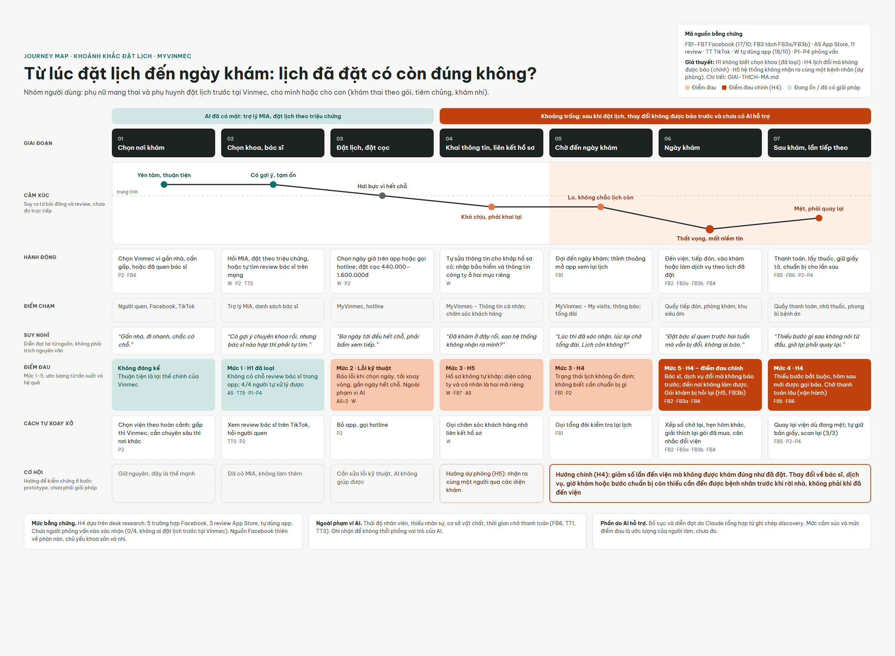

# Journey map – Khoảnh khắc Đặt lịch

- Ảnh: [journey-map.png](journey-map.png) · PDF: [journey-map.pdf](journey-map.pdf) · File nguồn: [journey-map.html](journey-map.html) (mở bằng trình duyệt)
- Nhóm người dùng: phụ nữ mang thai và phụ huynh đặt lịch trước tại Vinmec, cho mình hoặc cho con.
- Các mã H1–H5 và FB, TT, AS, W, P được giải thích ở [GIAI-THICH-MA.md](../GIAI-THICH-MA.md).

## Điểm đau theo giai đoạn

Mức 1–5 là ước lượng của người làm, dựa trên tần suất và hệ quả trong bằng chứng, chưa đo trực tiếp.

| Giai đoạn | Điểm đau | Mức | Giả thuyết | Nguồn |
| --- | --- | --- | --- | --- |
| 01 Chọn nơi khám | Không đáng kể; thuận tiện là lợi thế chính của Vinmec | – | – | P2, FB4 |
| 02 Chọn khoa, bác sĩ | Không có chỗ review bác sĩ trong app; 4/4 người tự xử lý được | 1 | H1 (đã loại) | AS, TT5, P1–P4 |
| 03 Đặt lịch, đặt cọc | Báo lỗi khi chọn ngày, tải xoay vòng, gần ngày hết chỗ. Lỗi kỹ thuật, ngoài phạm vi AI | 2 | – | AS×3, W |
| 04 Khai thông tin, liên kết hồ sơ | Hồ sơ không tự khớp; diện công ty và cá nhân là hai mã riêng | 3 | H5 | W, FB7, AS |
| 05 Chờ đến ngày khám | Trạng thái lịch không ổn định; không biết cần chuẩn bị gì | 3 | H4 | FB1, P2 |
| **06 Ngày khám** | **Bác sĩ, dịch vụ đổi mà không báo trước; đến nơi không làm được.** Gói khám bị hỏi lại | **5** | **H4** (và H5 với FB3b) | FB2, FB3a, FB3b, FB4 |
| 07 Sau khám, lần tiếp theo | Thiếu bước bắt buộc, hôm sau mới được gọi báo. Chờ thanh toán lâu (vận hành) | 4 | H4 | FB5, FB6 |

**Điểm đau chính:** giai đoạn 05–07, sau khi đặt lịch. Đây cũng là chỗ MyVinmec chưa có AI hỗ trợ, trong khi giai đoạn 01–03 đã có trợ lý MIA và đặt lịch theo triệu chứng.

## Cách đọc và giới hạn

- **Cảm xúc** được suy ra từ bài đăng và review, chưa đo trực tiếp.
- **Suy nghĩ** là câu diễn đạt lại từ nguồn, không phải trích nguyên văn.
- **Mức bằng chứng:** H4 dựa trên desk research (5 trường hợp Facebook, 3 review App Store, tự dùng app). Chưa người phỏng vấn nào xác nhận (0/4, không ai đặt lịch trước tại Vinmec).
- **Ngoài phạm vi AI:** thái độ nhân viên, thiếu nhân sự, cơ sở vật chất, thời gian chờ thanh toán (FB6, TT1, TT3).

## Thay đổi so với bản trên canvas

- Tách FB3 thành FB3a (siêu âm 4D bị xếp hàng 2D, thuộc H4) và FB3b (gói khám bị hỏi lại, thuộc H5).
- Thêm chú thích các mã giả thuyết vào khung "Mã nguồn bằng chứng".
- Sửa ô "Hướng chính (H4)" theo outcome của need statement chính thức ("giảm số lần đến viện mà không được khám đúng như đã đặt") thay cho bản nháp "biết sớm".

---

*Phần do AI hỗ trợ: bố cục và diễn đạt do Claude tổng hợp từ ghi chép discovery. Mức cảm xúc và mức điểm đau là ước lượng của người làm, chưa đo.*
