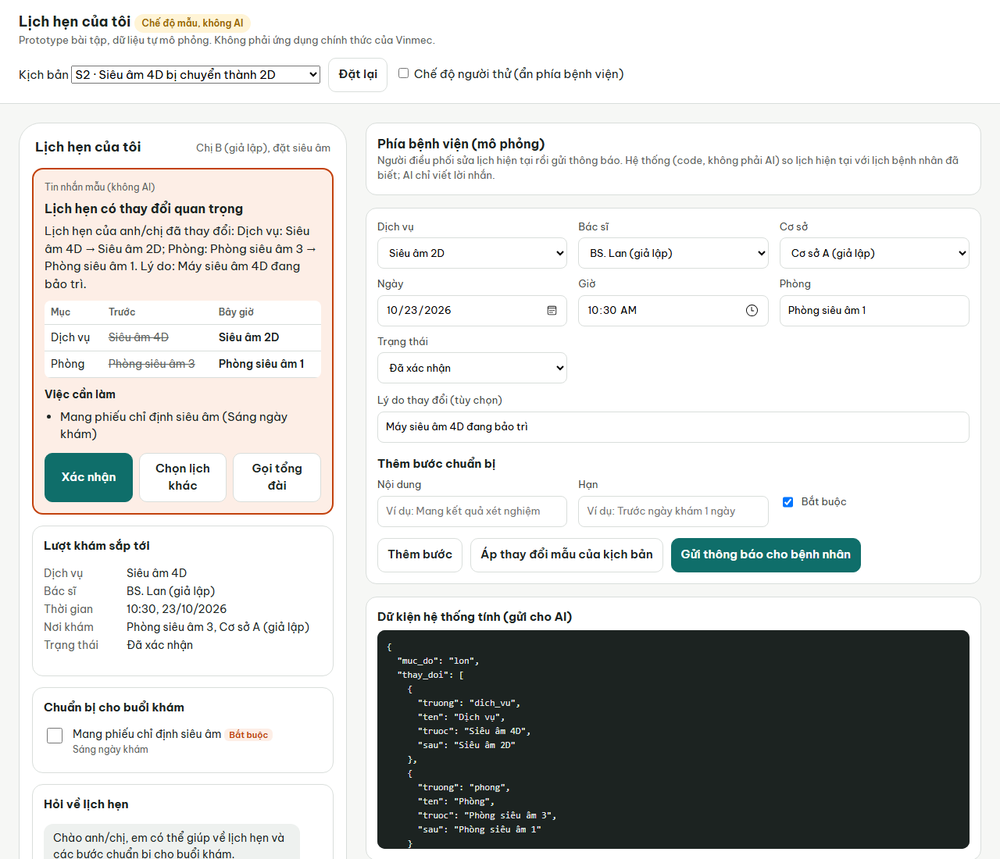

# Prototype có AI: "Lịch hẹn của tôi"

Báo cho bệnh nhân khi bác sĩ, dịch vụ, giờ khám hoặc bước chuẩn bị bắt buộc thay đổi sau khi đã đặt lịch, kèm việc cần làm và nút hành động. Kiểm chứng giả thuyết H4 của [need statement](../03-need-statement/need-statement.md). Chỉ dùng dữ liệu tự mô phỏng.



| File | Nội dung |
| --- | --- |
| [BRD-lite.md](BRD-lite.md) | BRD rút gọn: vấn đề kinh doanh, business case, phạm vi sáng kiến, chỉ số thành công |
| [PRD.md](PRD.md) | PRD: người dùng và tình huống, yêu cầu F1–F11 và N1–N7 kèm tiêu chí chấp nhận |
| [prompts.md](prompts.md) | Prompt, schema, nguyên tắc thiết kế an toàn, lịch sử thay đổi prompt |
| [test-log.md](test-log.md) | Kịch bản thử với người dùng và bảng log (**chưa thử, đang để trống**) |
| `server.mjs` | Máy chủ cục bộ, gọi Claude (`@anthropic-ai/sdk`) hoặc GPT (`openai`) qua SDK chính thức |
| `.env.example` | Mẫu file khóa API; sao chép thành `.env` (không đưa lên GitHub) |
| `lib/core.mjs` | So lịch, kiểm tra khẩn cấp, tin nhắn mẫu (không dùng AI) |
| `lib/prompts.mjs` | Prompt và JSON schema, dùng chung cho Claude và GPT |
| `public/index.html` | Giao diện: màn hình bệnh nhân và màn hình mô phỏng phía bệnh viện |
| `data/scenarios.json` | 6 kịch bản giả lập, dựa trên FB1–FB5 |
| `tests/core.test.mjs` | 9 kiểm thử cho phần không dùng AI |

## Cách chạy

Cần Node.js 20 trở lên.

```bash
cd 05-prototype
npm install
npm test                      # 9 kiểm thử phần không dùng AI
npm run start:offline         # chế độ mẫu, không cần khóa API
npm start                     # chế độ AI, đọc khóa từ file .env
```

**Khóa API:** sao chép `.env.example` thành `.env` rồi điền **một** trong hai khóa:

| Biến | Nhà cung cấp | Mô hình |
| --- | --- | --- |
| `ANTHROPIC_API_KEY` | Claude | `claude-opus-5-5` |
| `OPENAI_API_KEY` | GPT | `OPENAI_MODEL`, để trống thì `gpt-5` |

Có cả hai khóa thì `AI_PROVIDER=anthropic` hoặc `AI_PROVIDER=openai` quyết định dùng bên nào. Không có khóa nào thì tự chạy chế độ mẫu. Dòng khởi động trong terminal cho biết đang dùng nhà cung cấp và mô hình nào.

Mở <http://localhost:3000>. Link tiện cho buổi thử: `?kb=S2` chọn kịch bản, `&demo=1` tự áp thay đổi mẫu và gửi thông báo, `&tester=1` ẩn phía bệnh viện.

Khóa API chỉ nằm ở máy chủ cục bộ, không gửi xuống trình duyệt. `.env` đã nằm trong `.gitignore`, không đưa khóa vào repo.

Nhật ký phiên thử (`logs/phien-<ngày>.jsonl`) ghi nhà cung cấp, mô hình thật sự trả lời và phiên bản prompt cho mỗi câu do AI viết; khi AI lỗi và rơi về tin nhắn mẫu, nhật ký ghi lý do.

## Cách hoạt động

```text
Điều phối sửa lịch  →  code so "lịch bệnh nhân đã biết" với "lịch hiện tại"  →  AI viết lời nhắn từ kết quả so sánh
(phía bệnh viện)        (bảng Trước → Bây giờ, mức độ, bước chuẩn bị mới)        (tiêu đề, lời nhắn, việc cần làm)
                                                                               ↓
                              Bệnh nhân: Xác nhận · Chọn lịch khác · Gọi tổng đài  (ghi số giây để đo)

Câu hỏi của bệnh nhân  →  có từ khóa khẩn cấp?  → có: hướng dẫn gọi 115, không qua AI
                                                → không: AI phân loại (lịch / chuẩn bị / y khoa / khác);
                                                   câu y khoa được chuyển cho nhân viên y tế
```

Theo chính sách bảo vệ dữ liệu của Vinmec, màn hình bệnh nhân có ô **"Cho phép dùng AI…"** kèm giải thích AI làm gì. Tắt ô này thì người dùng vẫn nhận đủ thông báo bằng câu chữ viết sẵn, và không có dữ liệu nào được gửi cho nhà cung cấp AI.

| Kịch bản | Dựa trên | Mức độ do code tính |
| --- | --- | --- |
| S1 Đổi bác sĩ không báo trước | FB4 | Lớn |
| S2 Siêu âm 4D bị chuyển thành 2D | FB3a | Lớn |
| S3 Thêm bước chuẩn bị bắt buộc | FB2, FB5 | Lớn |
| S4 Trạng thái nhảy về chờ xác nhận | FB1 | Vừa |
| S5 Đổi giờ và phòng | Biến thể FB4 | Vừa |
| S6 Không có thay đổi (đối chứng) | Kiểm tra AI không báo nhầm | Nhắc chuẩn bị / giữ nguyên |

## Đã kiểm tra và chưa kiểm tra

| Phần | Trạng thái |
| --- | --- |
| So lịch, mức độ, từ khóa khẩn cấp, phân loại khi không có AI | 9/9 kiểm thử tự động đạt |
| Chế độ mẫu: 6 kịch bản và 4 loại câu hỏi qua máy chủ | Đã chạy thử, đúng như mong đợi |
| Giao diện | Đã chạy trên Edge, xem ảnh chụp ở trên |
| Khi gọi AI lỗi (khóa sai), tự rơi về tin nhắn mẫu | Đã thử với khóa không hợp lệ, cả Claude và GPT |
| Nhật ký ghi nhà cung cấp, mô hình; ghi lý do khi rơi về tin nhắn mẫu | Đã thử phần rơi về tin nhắn mẫu (khóa không hợp lệ); phần có AI chờ khóa hợp lệ |
| Người dùng tắt AI (PRD F11) | Đã thử: khi tắt, máy chủ không gọi nhà cung cấp AI và dùng câu chữ viết sẵn; nhật ký ghi "Người dùng đã tắt AI" |
| Chọn nhà cung cấp từ `.env` | Đã thử: không khóa → chế độ mẫu; khóa OpenAI → GPT; `AI_PROVIDER` chỉ bên thiếu khóa → cảnh báo, không lỗi |
| **Chế độ AI khi có khóa hợp lệ** | **Chưa chạy được**: máy làm bài không có khóa hợp lệ. Cần chạy thử cả 6 kịch bản và ghi kết quả trước khi thử với người dùng |
| **Thử với 2–3 người dùng** | **Chưa làm**, xem [test-log.md](test-log.md) |

## Giới hạn đã biết

- Danh sách từ khóa khẩn cấp là bản nháp, cần bác sĩ đầu mối duyệt. So khớp từ khóa có thể bỏ sót cách nói khác; prototype ưu tiên báo dư.
- Không có kênh gửi thật (SMS, Zalo, thông báo đẩy); thông báo chỉ hiện trong màn hình mô phỏng.
- Giả định lớn nhất: mọi thay đổi đều được nhân viên ghi vào hệ thống. Prototype không kiểm chứng được giả định này.
- Claude và GPT có thể viết lời nhắn và phân loại câu hỏi khác nhau dù cùng prompt và schema. Mỗi lần đổi nhà cung cấp hoặc mô hình, chạy lại 6 kịch bản và câu thử y khoa; trong một vòng thử, mọi người thử dùng cùng một mô hình.
