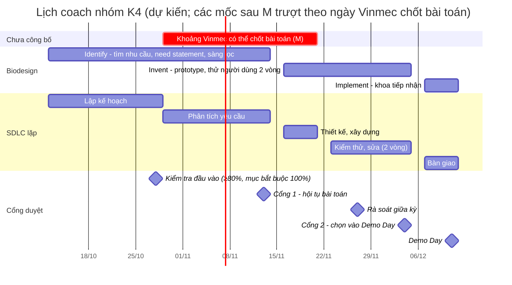

# Mình sẽ coach một nhóm làm bài này thế nào

Nhóm: 5–10 bạn K4, chia thành các cặp, mỗi cặp một khoảnh khắc. Mình vừa làm kỹ sư trong sprint, vừa chịu trách nhiệm để nhóm qua đúng hạn các cổng. Khung tham chiếu: Biodesign cho *làm đúng việc*, SDLC lặp có cổng duyệt cho *nhịp làm*, PMBOK 10 lĩnh vực cho *quản lý đủ mặt*, quản lý thay đổi cho *lúc phải đổi hướng* (chi tiết: [PHUONG-PHAP.md](../PHUONG-PHAP.md)).

## 1. Lịch

Ngày dự kiến theo đề: sprint bắt đầu thứ Năm 29/10/2026, tuần 0 khoảng 2,5 tuần trước đó, các cổng duyệt vào thứ Sáu.

**Điều chưa biết:** Vinmec chưa công bố khi nào sẽ chốt bài toán (khoa giao đề, hoặc khoa chọn bài ở Cổng 1). Vì vậy lịch dưới đây chia làm hai phần:

- **Trước khi chốt bài toán:** bám theo ngày cố định của sprint (onboard, đào tạo, checkpoint thứ Sáu).
- **Sau khi chốt bài toán:** mọi mốc tính từ ngày chốt, gọi là **M**. Lịch vẽ theo trường hợp M trùng Cổng 1 (13/11); nếu M đến sớm hay muộn hơn, xem mục 1.1.

| Tuần (mốc tương đối) | Biodesign / SDLC | Nhóm phải có trước thứ Sáu | Mình làm gì |
| --- | --- | --- | --- |
| 0 | Lập kế hoạch | NDA; 3 buổi đào tạo và **kiểm tra đầu vào** đạt (xem dưới bảng); mỗi cặp chọn 1 khoảnh khắc và viết câu hỏi sàng lọc người phỏng vấn theo hành vi (mẫu: [interview guide bản 2](../01-phong-van/02-interview-guide-v2.md#4-tuyển-người-phỏng-vấn)) | Chia cặp theo thế mạnh; buổi tập phỏng vấn đóng vai, dùng The Mom Test; ôn cùng nhóm trước kiểm tra đầu vào |
| 1 | Needs finding / phân tích yêu cầu | ≥3 phiếu quan sát hoặc phỏng vấn mỗi cặp, ghi theo mẫu chung; danh sách giả thuyết H1, H2… | Đi cùng mỗi cặp ít nhất một buổi; chấm phiếu trong 24 giờ |
| 2 (= M nếu đúng kế hoạch) | Need statement + sàng lọc nhu cầu | Need statement theo Biodesign, ma trận sàng lọc, journey map → **Cổng 1** | Tập dượt trình bày; gộp bài trùng *trước* cổng |
| 3 (M + 1 tuần) | Thiết kế, xây dựng | BRD rút gọn (vì sao làm, trong/ngoài phạm vi) rồi PRD (sản phẩm hành xử thế nào, tiêu chí chấp nhận), prototype trên dữ liệu giả | Duyệt phạm vi trước khi code; chặn tính năng ngoài need statement |
| 4 (M + 2 tuần) | Kiểm thử vòng 1 | Thử với 3–5 người dùng Vinmec, report 4 phần → **rà soát giữa kỳ** | Kiểm tra log thử có người thật, có số đo |
| 5 (M + 3 tuần) | Kiểm thử vòng 2 | Report vòng 2, đề xuất sơ bộ → **Cổng 2** | Phản biện như hội đồng: bằng chứng, rủi ro, chi phí |
| 6 (cố định) | Bàn giao, quản lý thay đổi | Prototype đóng gói, đề xuất, kế hoạch khoa tiếp nhận → **Demo Day** | Cùng khoa lên kế hoạch tiếp nhận theo ADKAR |

**Ngưỡng ≥80% của kiểm tra đầu vào là gì.** Theo đề, cuối tuần 0 (trước ngày onboard 29/10) có một bài kiểm tra sau 3 buổi đào tạo: định hướng, quy tắc dữ liệu, quan sát; phát triển an toàn; nội dung bắt buộc của Vinmec. Muốn được vào viện phải đạt **hai điều kiện cùng lúc**: điểm chung từ 80% trở lên, **và** các mục bắt buộc đúng 100%. Nghĩa là điểm cao vẫn trượt nếu sai một mục bắt buộc.

Vì sao mình coi đây là mốc đầu tiên: một bạn chưa đạt thì chưa được vào khoa từ ngày onboard, cặp của bạn đó mất những ngày quan sát đầu của tuần 1. Mình làm ba việc:

- **Hỏi ban tổ chức ngay tuần 0** những điều đề chưa nói: mục nào là bắt buộc, có được làm lại không, làm lại khi nào.
- **Ôn theo các mục dễ là bắt buộc nhất:** quy tắc dữ liệu và an toàn người bệnh (xin đồng ý, ẩn danh, không chụp người hay giấy tờ y tế, không dùng dữ liệu thật, không đưa lời khuyên y khoa). Đây cũng là những quy tắc mình đã áp dụng trong bài này.
- **Có phương án khi có bạn chưa đạt:** bạn đó làm phần desk research của cặp trong lúc chờ làm lại; nếu không được làm lại kịp, mình ghép lại cặp để không cặp nào vào khoa một mình.

Nhịp tuần: thứ Hai sau buổi V-RIC, mỗi cặp nói một câu "tuần này kiểm chứng điều gì"; thứ Tư sau buổi Vinmec, cập nhật giả thuyết; thứ Sáu checkpoint và nộp báo cáo tuần, mình tổng hợp một bảng xanh/vàng/đỏ cho người hướng dẫn.

### 1.1 Khi chưa biết lúc nào Vinmec chốt bài toán

Nguyên tắc: không để nhóm ngồi chờ đề, và không để công sức tìm nhu cầu bị bỏ phí khi đề đến.

- **Tìm nhu cầu ngay từ tuần 1**, không chờ. Need statement và ma trận sàng lọc của nhóm là thứ mang vào buổi làm việc với khoa, dù khoa giao đề sớm hay muộn.
- **Mốc sau M trượt theo M; Demo Day thì không.** Nếu M đến muộn, mình cắt phạm vi prototype (sửa BRD rút gọn), không cắt vòng thử người dùng.
- **Hỏi sớm:** ngay tuần 0, mình hỏi người hướng dẫn và bác sĩ đầu mối: khi nào biết bài toán, khoa sẽ giao đề hay chọn từ bài nhóm đề xuất. Mỗi thứ Sáu hỏi lại cho đến khi có câu trả lời.

| Tình huống | Dấu hiệu | Nhóm làm gì | Mình làm gì | Ảnh hưởng tới lịch |
| --- | --- | --- | --- | --- |
| **M sớm**: Vinmec giao bài toán khi onboard hoặc tuần 1 | Khoa giao đề cụ thể | Vẫn quan sát, phỏng vấn để viết need statement cho đề được giao; kiểm tra đề có đúng nhu cầu của người dùng không | Không để nhóm nhảy thẳng vào làm giải pháp; yêu cầu bằng chứng như khi tự tìm | Có thêm thời gian: thêm một vòng thử, hoặc thử kỹ hơn |
| **M đúng kế hoạch**: khoa chọn bài ở Cổng 1 (13/11) | Theo lịch | Theo bảng trên | Theo bảng trên | Không đổi |
| **M muộn**: sau Cổng 1, tối đa hết tuần 3 | Đến thứ Sáu tuần 2 chưa có quyết định | Giữ 2 hướng mạnh nhất từ ma trận sàng lọc; làm prototype nhanh, rẻ (bản giấy, màn hình tĩnh) cho hướng mạnh nhất để không mất tuần 3 | Báo người hướng dẫn ngay thứ Sáu tuần 2 (màu vàng); chuẩn bị sẵn hồ sơ 2 hướng để khoa chọn nhanh | Vòng thử 1 và 2 dồn sát nhau; phạm vi prototype hẹp lại |
| **Đề của khoa khác hướng nhóm đã tìm** | Đề giao không nằm trong ma trận sàng lọc | Đưa đề mới vào ma trận, chấm cùng tiêu chí; dùng lại bằng chứng, người phỏng vấn, mẫu phiếu đã có | Quản lý thay đổi: ghi lý do đổi hướng, giữ lại phần dùng được, giúp nhóm không nản | Như "M muộn" nếu đổi sau Cổng 1 |

Mức báo động: nếu hết tuần 3 vẫn chưa có bài toán, mình báo màu đỏ cho người hướng dẫn và đề xuất nhóm đi tiếp với hướng mạnh nhất của mình, để vẫn kịp hai vòng thử trước Cổng 2.

## 2. Cách gỡ khi nhóm kẹt

Mình hỏi trước, chỉ đưa đáp án khi nhóm đã thử.

| Dấu hiệu kẹt | Câu hỏi mình dùng | Việc làm ngay |
| --- | --- | --- |
| Phỏng vấn xong không ai đúng nhóm người dùng (bài này: 0/4) | "Người này đã *làm* hành vi mình cần kiểm chứng trong 3 tháng qua chưa?" | Viết lại câu sàng lọc theo hành vi; tuyển qua khoa, nhóm Facebook, không tuyển người quen |
| Ghi chép toàn ý kiến, không có lần cụ thể | "Lần gần nhất chuyện đó xảy ra là khi nào?" | Nghe lại một buổi cùng nhóm, đánh dấu câu hỏi giả định |
| Need statement đã chứa giải pháp ("app", "AI", "biết sớm") | "Câu này có loại trừ cách làm nào không?" | Tách outcome khỏi cách làm |
| Muốn làm prototype trước khi có nhu cầu | "Nếu prototype chạy tốt, bằng chứng nào cho thấy có người cần nó?" | Quay lại ma trận sàng lọc |
| Bằng chứng mới phủ nhận giả thuyết chính | "Điều kiện chuyển hướng mình đã đặt là gì?" | Đổi hướng theo điều kiện đã ghi, có nhật ký thay đổi |
| Nhóm ngồi chờ Vinmec giao đề | "Nếu mai khoa giao đề, mình mang bằng chứng gì vào buổi đó?" | Tiếp tục phỏng vấn, cập nhật ma trận sàng lọc (mục 1.1) |
| Hai cặp chọn trùng vấn đề | "Bài nào có bằng chứng mạnh hơn?" | Gộp trước Cổng 1; người của bài yếu hơn giữ phần việc rõ ràng |
| Nhóm im lặng, trễ báo cáo | Hỏi riêng: "Đang vướng ở đâu, mình gỡ được gì?" | Nhắc trong 24 giờ; trễ lần 2 thì báo người hướng dẫn |

## 3. Cách kiểm tra chất lượng

Mỗi cổng mình soát theo danh sách dưới. Phần lớn rút từ lỗi chính mình gặp khi rà soát bài này.

- **Bằng chứng:** mỗi giả thuyết có tiêu chí xác nhận khớp cỡ mẫu; ghi rõ bằng chứng là phỏng vấn hay desk research.
- **Nguồn:** mỗi số liệu trong slide đã được mở ra đối chiếu với bài gốc (bản nháp của mình từng sai năm xuất bản và tên tạp chí).
- **Nhất quán:** mã nguồn không trùng (bản nháp từng có hai dòng FB3); file giải thích mã dùng chung; need statement trong slide khớp với repo.
- **Đạo đức:** phiếu có đồng ý tham gia và đồng ý ghi âm; không có thông tin sức khỏe; ẩn danh; ghi rõ phần do AI tạo.
- **Prototype:** chỉ dữ liệu giả lập hoặc đã khử định danh; có đường chuyển tuyến khẩn cấp; log thử có người thật và có số đo, ghi rõ mô hình AI và phiên bản prompt đã dùng; khóa API không nằm trong repo.

Theo PMBOK, mình theo dõi 10 lĩnh vực bằng một bảng mỗi tuần, tập trung vào 5 lĩnh vực nhóm sinh viên hay bỏ sót: **phạm vi** (chặn tính năng thừa), **chất lượng** (danh sách trên), **rủi ro** (an toàn người bệnh trước tiên), **truyền thông** (báo cáo thứ Sáu) và **các bên liên quan** (bác sĩ đầu mối, điều dưỡng, khoa).
