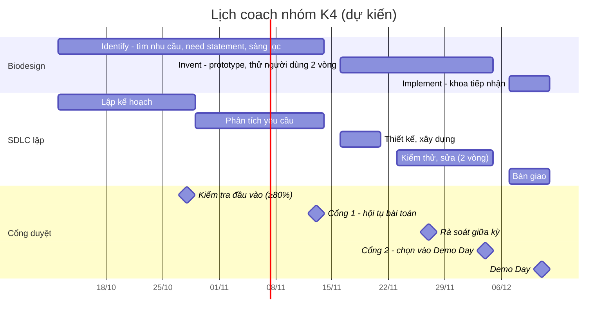

# Mình sẽ coach một nhóm làm bài này thế nào

Nhóm: 5–10 bạn K4, chia thành các cặp, mỗi cặp một khoảnh khắc. Mình vừa làm kỹ sư trong sprint, vừa chịu trách nhiệm để nhóm qua đúng hạn các cổng. Khung tham chiếu: Biodesign cho *làm đúng việc*, SDLC lặp có cổng duyệt cho *nhịp làm*, PMBOK 10 lĩnh vực cho *quản lý đủ mặt*, quản lý thay đổi cho *lúc phải đổi hướng* (chi tiết: [PHUONG-PHAP.md](../PHUONG-PHAP.md)).

## 1. Lịch

Ngày dự kiến theo đề: sprint bắt đầu thứ Năm 29/10/2026, tuần 0 khoảng 2,5 tuần trước đó, các cổng duyệt vào thứ Sáu.

| Tuần | Biodesign / SDLC | Nhóm phải có trước thứ Sáu | Mình làm gì |
| --- | --- | --- | --- |
| 0 | Lập kế hoạch | NDA, đào tạo bắt buộc đạt; mỗi cặp chọn 1 khoảnh khắc và viết câu hỏi sàng lọc người phỏng vấn | Chia cặp theo thế mạnh; buổi tập phỏng vấn đóng vai, dùng The Mom Test |
| 1 | Needs finding / phân tích yêu cầu | ≥3 phiếu quan sát hoặc phỏng vấn mỗi cặp, ghi theo mẫu chung; danh sách giả thuyết H1, H2… | Đi cùng mỗi cặp ít nhất một buổi; chấm phiếu trong 24 giờ |
| 2 | Need statement + sàng lọc nhu cầu | Need statement theo Biodesign, ma trận sàng lọc, journey map → **Cổng 1** | Tập dượt trình bày; gộp bài trùng *trước* cổng |
| 3 | Thiết kế, xây dựng | BRD rút gọn 1 trang (trong/ngoài phạm vi), prototype trên dữ liệu giả | Duyệt phạm vi trước khi code; chặn tính năng ngoài need statement |
| 4 | Kiểm thử vòng 1 | Thử với 3–5 người dùng Vinmec, report 4 phần → **rà soát giữa kỳ** | Kiểm tra log thử có người thật, có số đo |
| 5 | Kiểm thử vòng 2 | Report vòng 2, đề xuất sơ bộ → **Cổng 2** | Phản biện như hội đồng: bằng chứng, rủi ro, chi phí |
| 6 | Bàn giao, quản lý thay đổi | Prototype đóng gói, đề xuất, kế hoạch khoa tiếp nhận → **Demo Day** | Cùng khoa lên kế hoạch tiếp nhận theo ADKAR |

Nhịp tuần: thứ Hai sau buổi V-RIC, mỗi cặp nói một câu "tuần này kiểm chứng điều gì"; thứ Tư sau buổi Vinmec, cập nhật giả thuyết; thứ Sáu checkpoint và nộp báo cáo tuần, mình tổng hợp một bảng xanh/vàng/đỏ cho người hướng dẫn.

## 2. Cách gỡ khi nhóm kẹt

Mình hỏi trước, chỉ đưa đáp án khi nhóm đã thử.

| Dấu hiệu kẹt | Câu hỏi mình dùng | Việc làm ngay |
| --- | --- | --- |
| Phỏng vấn xong không ai đúng nhóm người dùng (bài này: 0/4) | "Người này đã *làm* hành vi mình cần kiểm chứng trong 3 tháng qua chưa?" | Viết lại câu sàng lọc theo hành vi; tuyển qua khoa, nhóm Facebook, không tuyển người quen |
| Ghi chép toàn ý kiến, không có lần cụ thể | "Lần gần nhất chuyện đó xảy ra là khi nào?" | Nghe lại một buổi cùng nhóm, đánh dấu câu hỏi giả định |
| Need statement đã chứa giải pháp ("app", "AI", "biết sớm") | "Câu này có loại trừ cách làm nào không?" | Tách outcome khỏi cách làm |
| Muốn làm prototype trước khi có nhu cầu | "Nếu prototype chạy tốt, bằng chứng nào cho thấy có người cần nó?" | Quay lại ma trận sàng lọc |
| Bằng chứng mới phủ nhận giả thuyết chính | "Điều kiện chuyển hướng mình đã đặt là gì?" | Đổi hướng theo điều kiện đã ghi, có nhật ký thay đổi |
| Hai cặp chọn trùng vấn đề | "Bài nào có bằng chứng mạnh hơn?" | Gộp trước Cổng 1; người của bài yếu hơn giữ phần việc rõ ràng |
| Nhóm im lặng, trễ báo cáo | Hỏi riêng: "Đang vướng ở đâu, mình gỡ được gì?" | Nhắc trong 24 giờ; trễ lần 2 thì báo người hướng dẫn |

## 3. Cách kiểm tra chất lượng

Mỗi cổng mình soát theo danh sách dưới. Phần lớn rút từ lỗi chính mình gặp khi rà soát bài này.

- **Bằng chứng:** mỗi giả thuyết có tiêu chí xác nhận khớp cỡ mẫu; ghi rõ bằng chứng là phỏng vấn hay desk research.
- **Nguồn:** mỗi số liệu trong slide đã được mở ra đối chiếu với bài gốc (bản nháp của mình từng sai năm xuất bản và tên tạp chí).
- **Nhất quán:** mã nguồn không trùng (bản nháp từng có hai dòng FB3); file giải thích mã dùng chung; need statement trong slide khớp với repo.
- **Đạo đức:** phiếu có đồng ý tham gia và đồng ý ghi âm; không có thông tin sức khỏe; ẩn danh; ghi rõ phần do AI tạo.
- **Prototype:** chỉ dữ liệu giả lập hoặc đã khử định danh; có đường chuyển tuyến khẩn cấp; log thử có người thật và có số đo.

Theo PMBOK, mình theo dõi 10 lĩnh vực bằng một bảng mỗi tuần, tập trung vào 5 lĩnh vực nhóm sinh viên hay bỏ sót: **phạm vi** (chặn tính năng thừa), **chất lượng** (danh sách trên), **rủi ro** (an toàn người bệnh trước tiên), **truyền thông** (báo cáo thứ Sáu) và **các bên liên quan** (bác sĩ đầu mối, điều dưỡng, khoa).

---

*Phần do AI hỗ trợ: Claude soạn bản nháp theo khung người làm đưa ra (Biodesign, PMBOK, SDLC, quản lý thay đổi) và từ các lỗi tìm được khi rà soát bài; người làm chỉnh lại theo cách dẫn dắt của mình.*
